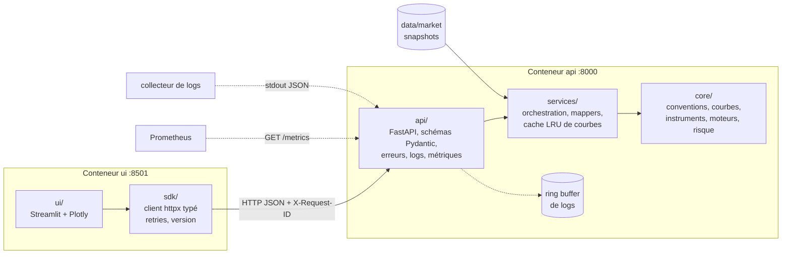

# Rate Derivatives Pricer

Un **pricer de dérivés de taux** extensible, de type production, en Python : bibliothèque quant en POO,
service FastAPI, SDK Python et dashboard Streamlit, livrés en conteneurs Docker.

> Statut : **Phases 0 à 3 terminées** (outillage et CI ; swap OIS €STR de bout en bout ; IRS vanille contre Euribor
> 3M/6M, bootstrap multi-courbes et risque par bump-and-reprice ; scénarios, carry/roll-down et USD SOFR par
> configuration ; tout validé contre QuantLib). **Phase 4 en cours** (Docker, observabilité, pricing batch, dashboard
> complet). Voir `docs/ROADMAP.md`.
>
> Les données de marché fournies (`data/market/EUR_2026-10-19.json`, `EUR_2026-10-20.json`, `USD_2026-10-19.json`)
> sont **synthétiques** (ADR-023, ADR-032, ADR-033).

## Objectifs

1. Apprendre le pricing de taux : bootstrap de courbes (OIS, multi-courbes), valorisation de swaps, risque (DV01,
   key-rate, convexité, scénarios, carry/roll-down).
2. Apprendre les pratiques de développement de production : architecture en couches, conception d'API, SDK,
   logging structuré, observabilité, Docker, CI.

## Périmètre de la v1

- Produits : swaps OIS, IRS vanilles (Euribor 3M/6M, multi-courbes). Devises : EUR, et USD (swaps OIS SOFR) ajouté
  par configuration.
- Risque : bump-and-reprice sur les instruments de calibration (par rates), avec re-bootstrap.
- Python + NumPy pur. QuantLib utilisée uniquement comme oracle de validation dans les tests.
- API sans état avec cache de courbes en mémoire ; pas de base de données ni d'authentification.

## Architecture



Les dépendances vont dans **un seul sens** (`ui -> sdk -> (HTTP) -> api -> services -> core`), règle vérifiée par
`import-linter` en CI. `core/` (bibliothèque quant, NumPy uniquement) ne connaît rien des couches web. Détails :
`docs/ARCHITECTURE.md`.

## Démarrage rapide avec Docker

Prérequis : Docker avec le plugin Compose (`docker compose version`).

```
git clone https://github.com/siearieldibloni-lgtm/rates-derivatives-pricer.git
cd rates-derivatives-pricer
docker compose up --build
```

Puis :

- dashboard : http://localhost:8501 ;
- API et sa documentation interactive : http://localhost:8000/docs ;
- métriques Prometheus : http://localhost:8000/metrics.

`docker compose up -d --wait` rend la main quand les deux conteneurs sont sains ; `docker compose logs -f api` suit
les logs JSON de l'API ; `docker compose down` arrête tout. Les variables d'environnement de l'API (`LOG_LEVEL`,
`CURVE_CACHE_SIZE`, `LOG_BUFFER_SIZE`...) se règlent dans `docker-compose.yml` (liste complète :
`docs/CONVENTIONS.md`, section 7).

Vérifier une plateforme démarrée (le même test tourne en CI) :

```
python scripts/smoke_test.py --api-url http://localhost:8000 --ui-url http://localhost:8501
```

## Démarrage en développement (sans Docker)

Prérequis : [uv](https://docs.astral.sh/uv/) (il installe Python 3.12 si besoin).

```
uv sync --all-extras
uv run pre-commit install    # une fois par clone : active les hooks git
uv run pytest
```

Lancer l'API, puis le dashboard dans un second terminal :

```
uv run uvicorn rate_derivatives_pricer.api.main:app --reload
uv run streamlit run src/rate_derivatives_pricer/ui/app.py
```

En local, `LOG_FORMAT=text` rend les logs lisibles ; `PRICER_API_URL` indique au dashboard où trouver l'API.

## Utilisation

Pricer un swap OIS par HTTP :

```
curl -s -X POST http://localhost:8000/v1/price -H "Content-Type: application/json" \
  -d '{"market": {"snapshot": "EUR_2026-10-19"},
       "trade": {"type": "ois_swap", "params": {"notional": 10000000, "fixed_rate": 0.0225,
                                                 "direction": "pay_fixed", "maturity": "5Y"}}}'
```

Ou avec le SDK Python (timeouts, retries avec backoff exponentiel, exceptions typées, vérification de version) :

```python
from rate_derivatives_pricer.sdk import PricerClient, ois_swap

with PricerClient("http://localhost:8000", verify_version=True) as client:
    priced = client.price("EUR_2026-10-19", ois_swap(10_000_000, 0.0225, "pay_fixed", "5Y"))
    print(priced.result.present_value, priced.result.par_rate, priced.request_id)
```

Un IRS vanille contre Euribor 6M, puis son risque (DV01 parallèle, par instrument de calibration, par courbe,
convexité) :

```python
from rate_derivatives_pricer.sdk import PricerClient, vanilla_irs

with PricerClient("http://localhost:8000") as client:
    swap = vanilla_irs(10_000_000, 0.025, "pay_fixed", "5Y", index="EURIBOR6M")
    priced = client.price("EUR_2026-10-19", swap)
    risk = client.risk(
        "EUR_2026-10-19", swap, ["parallel_dv01", "key_rate_dv01", "curve_dv01", "convexity"]
    )
    for measure in risk.result.measures:
        print(measure.measure, measure.value, measure.unit)
```

Scénarios (presets parallèle ±100 bp, steepener, flattener, twist, ou formes personnalisées), carry/roll-down sous
l'hypothèse de courbe inchangée, et l'USD (SOFR), ajouté par simple configuration :

```python
from rate_derivatives_pricer.sdk import PricerClient, ois_swap, scenario, vanilla_irs

with PricerClient("http://localhost:8000") as client:
    swap = vanilla_irs(10_000_000, 0.025, "pay_fixed", "10Y")
    shocked = client.scenarios(
        "EUR_2026-10-19",
        swap,
        ["parallel_up", "steepener"],
        [scenario("bear_steepener", {"2Y": 0.0, "10Y": 30.0})],
    )
    for result in shocked.result.scenarios:
        print(result.name, result.pnl)
    carry = client.carry_rolldown("EUR_2026-10-19", swap, horizon="3M").result
    print(carry.carry, carry.rolldown, carry.total)
    sofr = client.price("USD_2026-10-19", ois_swap(1e7, 0.033, "pay_fixed", "5Y", currency="USD"))
```

Un portefeuille en une requête : la courbe est construite une fois, et un trade invalide n'empêche pas les autres
d'être pricés (`status: "error"` et une erreur structurée pour lui seul) :

```python
from rate_derivatives_pricer.sdk import PricerClient, ois_swap, vanilla_irs

with PricerClient("http://localhost:8000") as client:
    trades = [
        ois_swap(1e7, 0.0225, "pay_fixed", "5Y"),
        vanilla_irs(5e6, 0.025, "receive_fixed", "10Y"),
    ]
    batch = client.batch_price("EUR_2026-10-19", trades, trade_ids=["OIS-5Y", "IRS-10Y"])
    print(batch.result.summary)
    for item in batch.result.results:
        print(item.trade_id, item.status, item.result.present_value if item.result else item.error)
```

## Observabilité et support

Chaque réponse porte un `request_id` (en-tête `X-Request-ID` et corps) et un bloc `diagnostics` (timings, cache,
avertissements, empreintes des entrées). À partir d'un `request_id`, le support reconstruit la chronologie complète
du calcul :

```
curl -s http://localhost:8000/v1/logs/<request_id>     # événements du ring buffer en mémoire
curl -s http://localhost:8000/v1/cache/stats           # compteurs du cache de courbes
curl -s -X DELETE http://localhost:8000/v1/cache       # vider le cache
curl -s http://localhost:8000/metrics                  # métriques Prometheus
docker compose logs api | grep <request_id>            # les mêmes événements, en JSON sur stdout
```

L'onglet **Diagnostic** du dashboard affiche les mêmes informations : timings et statut de cache des derniers appels,
statistiques du cache (avec bouton de vidage), chronologie des logs d'un `request_id`, et écarts mesurés contre
QuantLib par couche.

## Le cœur seul

Le cœur s'utilise aussi seul, par exemple dans un notebook :

```python
from pathlib import Path
from rate_derivatives_pricer.core.engines.base import engine_for
from rate_derivatives_pricer.core.market.bootstrap import CurveBuilder
from rate_derivatives_pricer.core.market.providers import FileMarketDataProvider
from rate_derivatives_pricer.core.registry import INSTRUMENTS

snapshot = FileMarketDataProvider(Path("data/market")).load_snapshot("EUR_2026-10-19")
env = CurveBuilder().build(snapshot)
swap = INSTRUMENTS.get("ois_swap")(
    {"notional": 1e7, "fixed_rate": 0.0225, "direction": "pay_fixed", "maturity": "5Y"},
    snapshot.valuation_date,
)
result = engine_for("ois_swap").price(swap, env)
```

## Documentation

| Fichier | Contenu |
|---|---|
| `CLAUDE.md` | Briefing et règles de travail pour Claude Code |
| `docs/ARCHITECTURE.md` | Couches, contrats, patterns |
| `docs/ROADMAP.md` | Phases et critères de réussite |
| `docs/CONVENTIONS.md` | Code, tests, tolérances, CI, configuration |
| `docs/API.md` | Contrat HTTP, erreurs, logs, SDK |
| `docs/DECISIONS.md` | Journal des décisions |
| `docs/PHASE1.md` | Guide pédagogique de la phase 1 : chaque fichier et son rôle |
| `docs/latex/pricing_ois.pdf` | Théorie, pratique et implémentation des swaps OIS |
| `docs/latex/pricing_irs.pdf` | Théorie, pratique et implémentation des IRS vanilles (multi-courbes, risque), avec exemple chiffré ; source `pricing_irs.tex`, chiffres générés par `generate_irs_data.py` |

## Langue

Documentation en français ; code, docstrings, commentaires de code et commits en anglais.

## Workflow de développement

Une phase = une branche = une PR. Avant de pousser :

```
uv run ruff check . && uv run mypy && uv run lint-imports && uv run pytest
```

La CI (GitHub Actions) rejoue ces contrôles, puis construit les images Docker, démarre la plateforme et lance
`scripts/smoke_test.py`.
